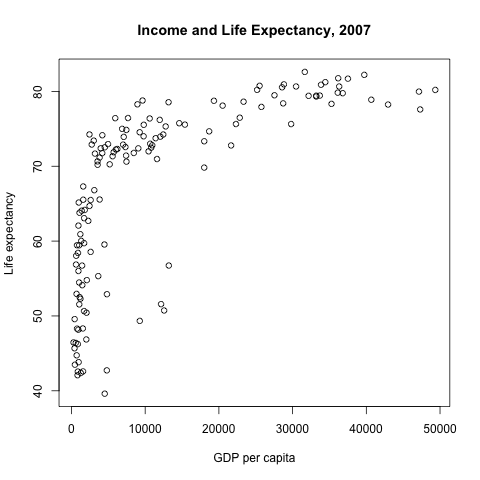

## Income and Life Expectancy

```{r}
#| echo: false
#| include: false

source("code/run_everything.R")
```

This report examines the relationship between income and life expectancy across countries.

## Results

### Average income and life expectancy by continent

@tbl-continent summarizes average life expectancy and GDP per capita by continent.

```{r}
#| label: tbl-continent
#| tbl-cap: "Average income and life expectancy by continent"
#| echo: false

table1 <- read.csv("output/table1.csv")
knitr::kable(table1)

```

### Income and life expectancy

As shown in @fig-income-life, countries with higher GDP per capita generally have higher life expectancy.

{#fig-income-life}

### Summary statistics

```{r}
#| echo: false

numbers <- readLines("output/numbers.txt")
cat(numbers, sep = "\n")
```

```{r}
#| echo: false

d <- read.csv("data/gapminder.csv")

yr <- max(d$year)
d_last <- d[d$year == yr, ]

mean_lifeexp <- mean(d_last$lifeExp)
```

In `r yr`, average life expectancy across countries was `r sprintf("%.1f", mean_lifeexp)` years.
